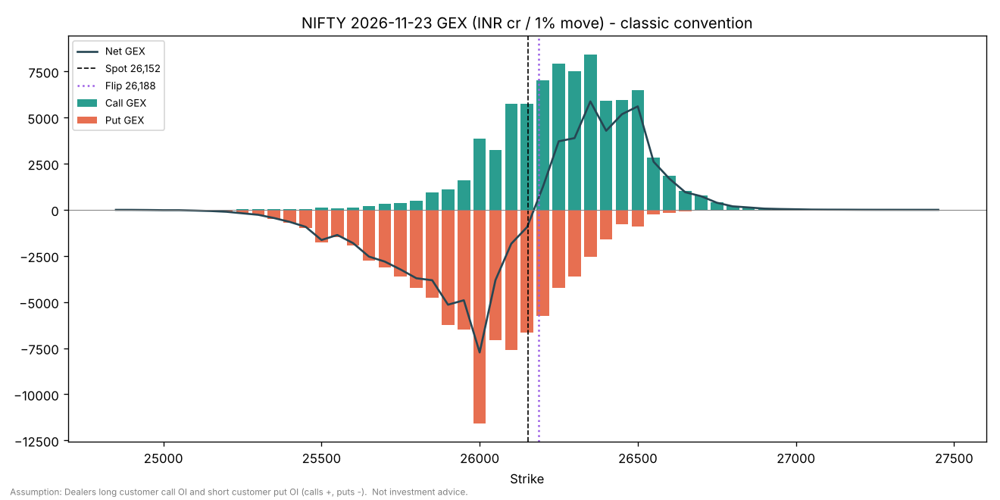
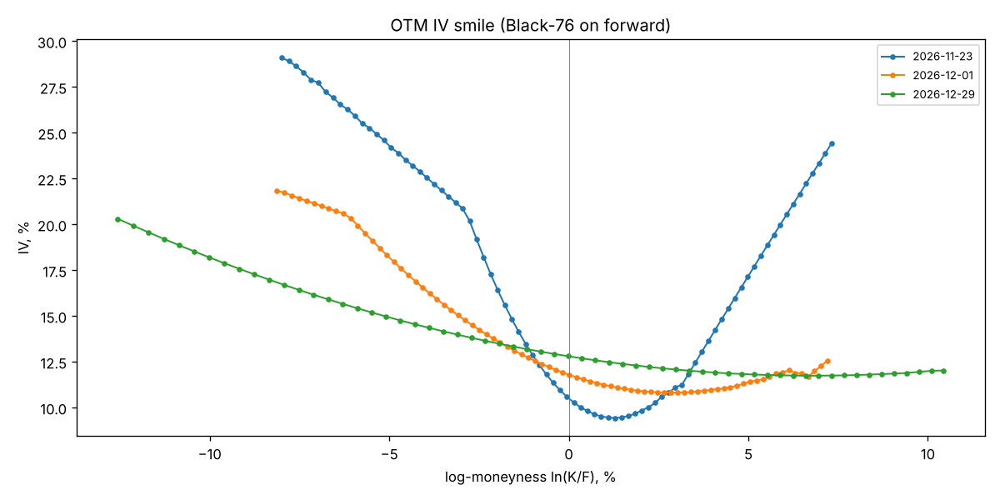
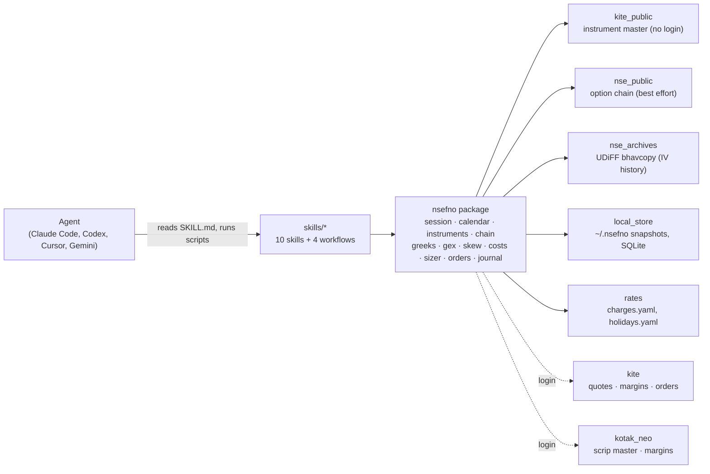

<div align="center">

# nse-fo-skills

**Agent Skills for Indian F&O traders: option chain, GEX, skew, expiry, costs, sizing and SEBI-aware order prep.**

Works with Claude Code, Codex CLI, Cursor, Gemini CLI and the Claude app's Skills tab.

[](https://github.com/MEMEO-PRO/nse-fo-skills/actions/workflows/ci.yml)


[Why](#why-this-exists) · [Quick start](#quick-start) · [Skills](#the-10-skills) · [Workflows](#workflows) · [How it works](#how-it-works) · [Accuracy](#accuracy-and-testing) · [Guardrails](#compliance-guardrails) · [Disclaimer](#disclaimer)

</div>

> [!IMPORTANT]
> This project is **analytics tooling, not investment advice**. The authors are not SEBI-registered advisers or research analysts. The skills never output buy or sell calls, targets or stops, and orders are only sent after you confirm them. Read [DISCLAIMER.md](DISCLAIMER.md).

---

## Why this exists

General-purpose coding agents are good at maths but get Indian derivatives mechanics wrong, because the rules keep changing and most of their training data is out of date. These are real examples, all handled by this pack and covered by its tests:

| An agent working from memory says | What is true (Nov 2026) | How the pack handles it |
|---|---|---|
| "NIFTY lot size is 75" (or 25, or 50) | **65** from the Jan-2026 series | Lot size is read from the day's instrument master, **for each expiry** |
| "SENSEX lot is 20" / "SENSEX lot is 25" | **Both are correct at once.** It is 20 for Nov/Dec-2026 expiries and 25 from Jan-2027 | `nsefno master lots SENSEX` lists the lot for every series |
| "NIFTY expires on Thursday" | It moved to **Tuesday** on 1 Sep 2025. SENSEX moved to Thursday | The rule set and the master agree, and a test checks this against the live exchange list |
| "Next NIFTY expiry is Tue 24 Nov" | **Mon 23 Nov**, because 24 Nov is Guru Nanak Jayanti and expiry moves to the previous trading day | Official 2026 holiday list; the output shows `shifted_from` and the reason |
| "STT on option sells is 0.0625%" (or 0.1%) | **0.15%** of premium from 1 Apr 2026 (Budget 2026). Futures are **0.05%** | Rates are dated, each has a source, and CI fails if the rate file is older than 90 days |
| "BANKNIFTY weekly expiry" | Weekly contracts were discontinued in Nov 2024. It is **monthly only** | Rules per index in `indices.yaml` |
| Black-Scholes on spot with a made-up dividend yield | Index options are European and cash-settled, so price them with **Black-76 on the forward** | IVs are solved on bid/ask mids against the put-call-parity forward |

## What it looks like

Ask your agent *"what's the NIFTY gamma posture into expiry?"* and the `gex-dealer-positioning` skill runs:

```text
**NIFTY 2026-11-23 GEX** (classic convention)
- Spot 26,152.35 vs flip 26,188: below -> net GEX -11,304.85 cr/1% => negative gamma (hedging amplifies moves)
- Call wall 26,350 | Put wall 26,000
- Assumption: Dealers long customer call OI and short customer put OI (calls +, puts -).

| Strike | Call GEX cr | Put GEX cr | Net cr |
|---|---|---|---|
| 26000 | 3851.43 | -11582.09 | -7730.66 |
| 26350 | 8430.10 | -2552.11 | 5878.00 |
| 26500 | 6500.51 | -891.60 | 5608.91 |
...
```

<p align="center">
  
  
</p>
<p align="center"><sub>Charts are rendered from the repo's <b>synthetic</b> test fixtures. The repo ships no NSE market data.</sub></p>

Ask *"what does 2 lots of a 26200/26400 bull call spread cost round trip?"* and `fno-cost-calculator` uses the live lot size (65) and the 2026 rates:

```text
| Phase | Leg               | Turnover  | Brokerage | STT   | Txn  | SEBI | Stamp | GST  | Total |
| entry | BUY 130 CE @ 82.0 | 10,660.00 | 20.0      | 0.0   | 3.79 | 0.01 | 0.32  | 4.28 | 28.4  |
| entry | SELL 130 CE @ 31.0| 4,030.00  | 20.0      | 6.04  | 1.43 | 0.0  | 0.0   | 3.86 | 31.34 |
| exit  | SELL 130 CE @ 82.0| 10,660.00 | 20.0      | 15.99 | 3.79 | 0.01 | 0.0   | 4.28 | 44.07 |
| exit  | BUY 130 CE @ 31.0 | 4,030.00  | 20.0      | 0.0   | 1.43 | 0.0  | 0.12  | 3.86 | 25.42 |
| Total |                   |           | 80.0      | 22.03 | 10.44| 0.02 | 0.44  | 16.28| 129.23|
Breakeven: 0.994 points of premium on 130 units just to cover costs.
```

## Quick start

### 1. Install (about 60 seconds)

```bash
git clone https://github.com/MEMEO-PRO/nse-fo-skills
cd nse-fo-skills
pip install -e ".[charts]"        # numpy, scipy, pyyaml, requests (+ matplotlib for charts)
nsefno expiry NIFTY --md          # smoke test; no login needed
```

### 2. Connect your agent

| Agent | How to install |
|---|---|
| **Claude Code** | Copy or symlink the skill folders: `ln -s "$PWD"/skills/* ~/.claude/skills/` (user scope) or into `.claude/skills/` of a project |
| **Claude app (Skills tab)** | `python scripts/build_packages.py` → upload any `skill-packages/<name>.skill` (each one bundles `nsefno`) |
| **Codex CLI / Cursor / Gemini CLI** | Point the agent at `skills/<name>/SKILL.md`; all of them follow the [Agent Skills](https://agentskills.io/specification) format |

### 3. Ask questions like a trader

- *"Lot size of NIFTY next expiry 26000 CE?"*
- *"Is it expiry tomorrow? How many sessions left for SENSEX?"*
- *"Show the BANKNIFTY chain: ATM IV, straddle, PCR, max pain."*
- *"Where is the gamma flip today, and what changed since the morning?"*
- *"Is NIFTY put skew steeper than usual? Show the term structure."*
- *"With ₹5L and 2% risk, how many lots of this iron condor can I do?"*
- *"Prepare (don't send) the orders for that condor."*

### No-login starter path

Seven skills run with **no broker account**. They use the public Kite instruments dump (contract metadata), the NSE public option chain, NSE's official bhavcopy archive, and the bundled rate and holiday tables.

## The 10 skills

| # | Skill | What it answers | Login | Tier |
|---|---|---|---|---|
| 1 | [`nse-instrument-master`](skills/nse-instrument-master/SKILL.md) | Turns "NIFTY 23 Nov 26000 CE" into the exact symbol, token, lot size, tick and expiry. Never trusts lot sizes from memory | No | Free |
| 2 | [`fno-expiry-calendar`](skills/fno-expiry-calendar/SKILL.md) | Next N expiries, weekly vs monthly, holiday shifts, sessions to expiry, and IST market state | No | Free |
| 3 | [`option-chain-snapshot`](skills/option-chain-snapshot/SKILL.md) | Clean chain with our own Black-76 IVs and Greeks, ATM, straddle, expected move, PCR, max pain | No | Free |
| 4 | [`iv-skew-analyzer`](skills/iv-skew-analyzer/SKILL.md) | OTM smile, 25Δ/10Δ risk reversal and butterfly, ATM term structure, IV percentile and rank | No | Free |
| 5 | [`gex-dealer-positioning`](skills/gex-dealer-positioning/SKILL.md) | GEX by strike, zero-gamma flip, call and put walls, with the dealer assumption **always stated** | No | Free |
| 6 | [`fno-cost-calculator`](skills/fno-cost-calculator/SKILL.md) | Round trip brokerage, STT, exchange, SEBI, stamp and GST, plus breakeven in points | No | Free |
| 7 | [`fno-position-sizer`](skills/fno-position-sizer/SKILL.md) | Units by risk budget and margin, exact max loss and breakevens, naked-leg warnings | No | Free |
| 8 | [`broker-margin-check`](skills/broker-margin-check/SKILL.md) | SPAN + exposure margin and hedge benefit for a basket (Kite, Kotak Neo) | Yes | Pro |
| 9 | [`sebi-order-prep`](skills/sebi-order-prep/SKILL.md) | Dry-run payloads with freeze slicing, tick and band checks, a <10 orders/s throttle and Algo-ID. Sends only after you confirm | Yes | Pro |
| 10 | [`fno-trade-journal`](skills/fno-trade-journal/SKILL.md) | Plans and fills with exact costs, plus a weekly review (win rate, cost drag, slippage vs plan) | No | Pro |

Every skill returns a **JSON envelope** (`source`, `fetched_at`, `stale_after`, `data`, `warnings`, `assumptions`, `disclaimer`) so that skills can chain. Add `--md` to get a compact markdown summary for the chat. [`skills-index.yaml`](skills-index.yaml) is the single source of truth for this list.

## Workflows

Manifests in [`workflows/`](workflows) chain skills toward an outcome, with decision gates between steps:

| Workflow | Chain | You get |
|---|---|---|
| [`premarket-fno-check`](workflows/premarket-fno-check.yaml) | expiry → chain → skew → GEX | A one-page posture: expiry, ATM and expected move, PCR and max pain, skew and term structure, GEX regime, flip and walls, and what changed since yesterday |
| [`trade-plan-to-order`](workflows/trade-plan-to-order.yaml) | master → cost → size → margin → order prep | A sized, costed, compliance-checked **dry-run** order |
| [`expiry-day-risk`](workflows/expiry-day-risk.yaml) | expiry → chain → GEX → size | Gamma near the money, distance to walls, and units over budget |
| [`weekly-review`](workflows/weekly-review.yaml) | journal → cost | Win rate, cost drag, slippage and P&L by setup |

Try it: *"Run the premarket-fno-check workflow for NIFTY."*

## How it works



Skills never call a broker SDK directly. They go through the shared `nsefno` package, and **only adapters touch the network**. To add Upstox, Dhan or Fyers you write one adapter file, and no skill logic changes.

```text
nse-fo-skills/
├── skills/<name>/SKILL.md, scripts/, references/   # the 10 skills
├── workflows/*.yaml                                # outcome-oriented chains
├── skills-index.yaml                               # single source of truth
├── nsefno/                                         # shared package (pip install -e .)
│   ├── adapters/  kite · nse_public · nse_archives · kotak_neo · local_store
│   ├── data/      charges.yaml · holidays.yaml · indices.yaml (dated, sourced)
│   └── greeks · chain · gex · skew · costs · sizer · orders · journal · calendar · session · cli
├── tests/                                          # 115 offline tests, synthetic fixtures, golden output
└── scripts/  validate_index.py · build_packages.py · make_fixtures.py
```

### Rules every adapter follows

- **IST everywhere.** Pre-open, open, closed, weekend and holiday state comes from a single function (`nsefno.session.market_state`).
- **No hardcoded quantities.** Lot size, tick size, freeze quantity and expiry come only from the instrument master.
- **Freshness is enforced.** Every output carries `stale_after`, and the GEX, chain and skew commands **refuse** a chain older than that (`StaleDataError`) unless you pass `--allow-stale`.
- **Secrets live only in env vars or the OS keychain.** Order logs go through a redaction filter.

### Methodology in one screen

| Quantity | Method |
|---|---|
| Forward | Median of K + (C − P)·e^{rt} over the 5 strikes nearest spot (mids). Falls back to futures, then spot carry |
| IV | Black-76 on the forward, solved with Brent's method on bid/ask mids. Exchange IV is used only as a fallback |
| Time | ACT/365 to 15:30 IST on expiry day, at minute precision |
| GEX | Γ × OI(contracts) × lot × S² × 1%, in ₹ crore per 1% move. Two explicit sign conventions (`classic`, `dealer_short`) |
| Flip | Zero crossing of net GEX re-priced on a ±6% spot grid (IV held fixed per strike) |
| Skew | RR25 = IV(25Δc) − IV(25Δp), BF25 = ½(wings) − ATM. OTM options only, interpolated in delta space |
| IV percentile | Daily ATM IV of the nearest expiry with ≥2 days to go, from official NSE bhavcopy closes |
| Max loss | Exact, from the piecewise-linear expiry payoff (kinks at strikes). Unlimited risk is detected from the tail slope |

Full notes: [GEX method](skills/gex-dealer-positioning/references/gex-method.md) · [skew method](skills/iv-skew-analyzer/references/skew-method.md) · [field glossary](skills/option-chain-snapshot/references/field-glossary.md) · [charges](skills/fno-cost-calculator/references/charges.md) · [contract specs](skills/nse-instrument-master/references/contract-specs.md) · [SEBI algo rules](skills/sebi-order-prep/references/sebi-algo-rules.md)

## Accuracy and testing

```bash
pip install -e ".[dev]" && pytest          # 115 tests, offline, about 5 s
python scripts/validate_index.py           # Agent Skills spec + index/workflow consistency
```

| Layer | What is checked |
|---|---|
| **Pricing** | Black-76 against Haug's textbook value (1.7011), put-call parity, IV round trips over strikes and vols, Greeks against finite differences, delta→strike inversion |
| **Calendar** | All 9 holiday-driven expiry shifts in 2026 (NSE Tuesday and BSE Thursday). Rule projections are checked against the **live exchange contract list** from 21 Nov 2026. Market state at 09:05, 09:15, 15:29:59, 15:30, weekend and holiday |
| **Instruments** | Ten resolver input forms. The SENSEX 20→25 per-series lot transition. Kotak Neo quirks (1980 epoch, strikes in paise) |
| **Chain** | NSE JSON layout parsing, recovery of the generator's forward and IV, max pain against brute force, stale-chain refusal, snapshot diffing |
| **GEX** | The per-strike formula, net = Σ strikes, the flip being a real zero crossing, walls bracketing spot, linearity in lot size, both conventions, and a golden regression file |
| **Costs** | Hand-computed legs. STT before and after 1 Apr 2026. NSE transaction rates before and after 1 Mar 2026. BSE rates, the futures min(0.03%, ₹20) rule, exercise STT |
| **Sizing** | Bull call spread, iron condor, short strangle (unlimited and naked), long put, short futures, and each binding constraint |
| **Orders** | Freeze slicing edge cases, tick and band checks, a token bound to the payload with a 60 s expiry, blocks in pre-open and after close, stop on the first error, a sliding-window throttle (never more than 8 per second), log redaction |
| **Packaging** | Each `.skill` zip runs **in isolation** (`python -I`) with the vendored package |
| **CI** | Python 3.11 to 3.13, ruff, index validator, package build, gitleaks secret scan, and a weekly run that fails if `charges.yaml` is more than 90 days old |

> [!NOTE]
> **Live sources.** The instrument master (Kite public dump) and the NSE bhavcopy archive were checked live while this was built. The real bhavcopy IV history confirmed the holiday-shifted expiries (Mon 19 Oct, Mon 9 Nov 2026). The NSE public option-chain endpoint is unofficial: the parser is tested against its documented JSON layout, but NSE changes it without notice, so it is **best effort** and not suitable for live trading. Use `--source kite` for a robust feed.

## Compliance guardrails

| Risk | What the pack does |
|---|---|
| Reading as advice (SEBI RA/IA rules) | Every SKILL.md has a `## Never` section: no buy/sell, targets or stops. Each output carries a disclaimer |
| Retail algo framework (in force from 1 Apr 2026) | Throttle at 8 orders/s, below the 10/s registration threshold. Algo-ID tag field. Warnings for a missing static IP and a non-IST host |
| Accidental live orders | Dry run by default. Sending needs an HMAC token that is bound to the exact payload and expires in 60 s. Blocked outside 09:15–15:30 IST. `max_lots_per_leg` cap. Stops on the first error |
| Exchange rejects | Quantity must be whole lots from the master. Slices stay below the freeze quantity. Tick size and price band are checked |
| Redistributing data | No NSE market data in the repo, and every user fetches with their own session |
| Credential leaks | Keys only in env or keychain, redacted logs, gitleaks in CI |
| Stale rates after a budget | Each rate has `effective_from` and a source, and CI fails at 90 days |

## Configuration

`~/.nsefno/config.yaml` (optional):

```yaml
broker: kite              # kite | kotak_neo
max_lots_per_leg: 10      # hard cap enforced by sebi-order-prep
orders_per_second: 8      # must stay < 10 (SEBI threshold)
algo_id: null             # exchange/broker Algo-ID tag, if you have one
static_ip: 203.0.113.7    # the IP whitelisted with your broker
product: NRML
```

| Env var | Used by |
|---|---|
| `KITE_API_KEY`, `KITE_ACCESS_TOKEN` | Kite quotes, margins and orders |
| `NEO_CONSUMER_KEY`, `NEO_MOBILE`, `NEO_UCC`, `NEO_MPIN`, `NEO_TOTP` | Kotak Neo (`pip install neo_api_client`) |
| `NSEFNO_HOME` | Data directory (default `~/.nsefno`) |
| `NSEFNO_MASTER` | Default instrument master (`kite_public`) |

## CLI reference

```bash
nsefno session [--exchange BSE]                         # market state now
nsefno expiry NIFTY -n 6 [--no-master]                  # calendar
nsefno master resolve "NIFTY 23 Nov 26000 CE"           # contract lookup
nsefno master lots SENSEX                               # lot per series
nsefno chain NIFTY --expiry next --save                 # snapshot (+store)
nsefno gex NIFTY --expiry next --chart gex.png --compare-previous
nsefno skew NIFTY --expiries next,far,monthly --chart skew.png
nsefno ivhistory NIFTY --days 260                       # backfill from bhavcopy
nsefno cost --index NIFTY --leg "BUY 2 CE 26200 @ 82" --leg "SELL 2 CE 26400 @ 31"
nsefno size --index NIFTY --capital 500000 --risk-pct 2 --spot 26150 --leg "..." --leg "..."
nsefno margin --broker kite --legs basket.json
nsefno order prep --plan plan.json --index NIFTY --freeze-qty 1800
nsefno order send --sha <payload_sha256> --confirm <token>
nsefno journal plan|fill|import|review ...
```

Every command accepts `--md` (markdown output), `--today YYYY-MM-DD` and `--lot-size N` (an override).

## Roadmap

- **v0.2:** `orderbook-microstructure` on TBT and 1-second data (queue imbalance, OFI, sweep detection), `oi-buildup-scanner`, `event-risk-calendar` (RBI, CPI, results, US data), `backtest-fno` with Indian costs and lot sizes
- Adapters for Upstox, Dhan and Fyers (see the [adapter guide](CONTRIBUTING.md#adding-a-broker-adapter-upstox-dhan-fyers-) and open `good first issue` tickets)
- Per-strike freeze quantities from the exchange file, and AMO support

## Contributing

PRs are welcome, especially broker adapters and corrections with an official source. See [CONTRIBUTING.md](CONTRIBUTING.md). The core rules are: no hardcoded quantities, every rate dated and sourced, and no advice.

## Disclaimer

Analytics only. This is not investment advice and not a recommendation to buy or sell. The authors are not SEBI-registered investment advisers or research analysts. The pack is not designed for fully automated trading or signal outsourcing. Derivatives carry substantial risk. Full text: [DISCLAIMER.md](DISCLAIMER.md).

## Sources

- STT revision from 1 Apr 2026: [Zerodha bulletin](https://zerodha.com/marketintel/bulletin/445377/revision-in-stt-securities-transaction-tax-from-1st-april-2026), [ICICI Direct](https://www.icicidirect.com/ilearn/futures-and-options/articles/stt-changes-in-budget-2026-what-f-o-traders-should-know)
- Exchange, SEBI and stamp charges: [Zerodha charges](https://zerodha.com/charges/) · Kotak Neo brokerage: [pricing](https://www.kotakneo.com/pricing/)
- Lot-size revision (effective after 30 Dec 2025): [Zerodha bulletin](https://zerodha.com/marketintel/bulletin/429705/revision-in-lot-size-of-index-derivative-contracts-from-december-30-2025)
- Expiry day changes (1 Sep 2025): [Business Standard](https://www.business-standard.com/markets/news/nse-bids-adieu-to-thursday-expiry-as-dates-swap-come-into-effect-explained-125082800635_1.html)
- 2026 trading holidays: NSE circulars NSE/FAOP/71777 and NSE/FAOP/72262 ([NSE holidays](https://www.nseindia.com/resources/exchange-communication-holidays))
- Retail algo framework (1 Apr 2026): [Fyers summary](https://support.fyers.in/portal/en/kb/articles/what-are-the-new-sebi-rules-for-retail-algo-trading-from-april-01-2026)
- Format inspiration: [tradermonty/claude-trading-skills](https://github.com/tradermonty/claude-trading-skills) · [Agent Skills specification](https://agentskills.io/specification)

<div align="center"><sub>MIT licensed · Built for traders who check the contract note.</sub></div>
